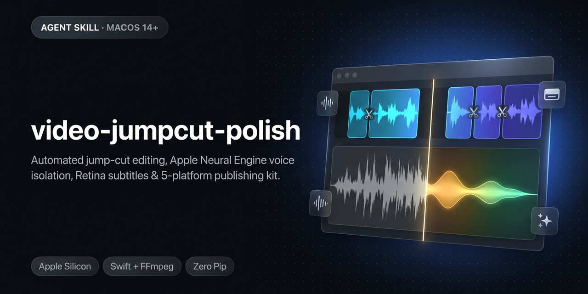

<div align="center">



<br />
<br />

# video-jumpcut-polish

**Drop in a raw camera video. Get back a broadcast-mastered cut, Retina subtitles, subject-faithful covers, and 5-platform SEO copy — natively on macOS.**

[](#device-compatibility)
[](#device-compatibility)
[](#requirements)
[](#quick-start)
[](./LICENSE)

[Quick Start](#quick-start) · [Pipeline](#how-it-works) · [Genre Adaptation](#genre-adaptive-pipeline) · [Features](#feature-matrix) · [Compatibility](#device-compatibility) · [Architecture](#repository-architecture)

</div>

---

## Why `video-jumpcut-polish`?

Recording a 3-minute talking-head, podcast clip, or product unboxing takes minutes. The post-production and publishing busywork takes hours: cutting dead air and filler words, taming room echo, fixing blown-out iPhone HDR, blurring private screens, designing covers that don't hallucinate your face or hardware, and writing titles that pass platform truncation and SEO checks.

**`video-jumpcut-polish`** turns your AI coding agent into an automated macOS post-production studio with **zero Python third-party dependencies** — combining `ffmpeg`, Python standard library, and native macOS Swift helpers powered by **Apple Neural Engine (`AUSoundIsolation`)**, **Apple Vision**, **CoreText**, and **VideoToolbox**.

| ⚡ **~2s Media Analysis** | 🎯 **0.0 ms A/V Sync** | 🪶 **Zero `pip install`** | 🌍 **5-Platform Publish Kit** |
| :--- | :--- | :--- | :--- |
| Keyframe-only overview sheet & 10 ms RMS pause profiling | Auto-compensates `AUSoundIsolation` 76.4 ms lookahead latency | Pure Python stdlib + auto-compiled native Swift helpers | Tailored titles, copy, chapters & SEO linter for 5 platforms |

---

## Quick Start

### 1. Install Prerequisites (macOS)

```bash
xcode-select --install   # Provides swiftc for native macOS helpers
brew install ffmpeg      # Provides ffmpeg & ffprobe
```

### 2. Install the Skill

```bash
npx skills add zh30/video-jumpcut-polish
```

<details>
<summary>Alternative installation methods (Antigravity symlink / Project workspace)</summary>

**Antigravity Global Skill (recommended if you want to pull updates with `git pull`):**
```bash
git clone https://github.com/zh30/video-jumpcut-polish.git ~/Code/video-jumpcut-polish
ln -s ~/Code/video-jumpcut-polish/skills/video-jumpcut-polish ~/.gemini/config/skills/video-jumpcut-polish
```

**Workspace-Scoped Skill:**
Copy `skills/video-jumpcut-polish/` into your repository's `.agents/skills/video-jumpcut-polish/` directory.

</details>

### 3. Run It With Natural Language

Just share a raw video path with your agent:

```text
Polish /path/to/raw_video.mp4 — cut pauses and filler words, isolate my voice,
add subtitles, blur any private info on my desk, and build the full publishing kit.
```

> [!NOTE]
> On first run, the scripts automatically compile the four Swift helpers into `scripts/.bin/` (`swiftc -O`, ~2 seconds one-time). Your original camera file is **never modified** — everything is exported into a clean `<video_name>_成品发布包/` delivery folder beside it.

---

## How It Works


---

## Genre-Adaptive Pipeline

Instead of forcing one rigid template onto every recording, the agent classifies your footage during Step 2 and automatically adapts pacing, neural denoising, loudness, framing, subtitles, covers, and copywriting:

| Genre | Pacing & Jump-Cuts | Voice & Loudness | Framing / Punch-In | Subtitles | Cover & Copy Strategy |
| :--- | :--- | :--- | :--- | :--- | :--- |
| **Solo Talking-Head** | Crisp & punchy (`0.12–0.38s` beats); removes all fillers & stutters | `AUSoundIsolation` 90%<br>`-15 LUFS` | `1.12×` zoom with head-safe `zoom_y=0.35` anchor | Retina highlighted burn-in + `.srt` + chapter pills | Portrait-faithful cover + PAS key-takeaway copy |
| **Video Podcast** | Human breathing room (`0.22–0.65s` beats); trims only dead air & major stumbles | `AUSoundIsolation` 88%<br>`-16 LUFS` | Subtle `1.06×` on major chapter shifts only | `.srt` sidecar + subtle chapter badges | Editorial podcast cover + Show Notes, `00:00` chapters & golden quotes |
| **Product Unboxing / Review** | Tight speech while preserving tactile reveals & clicks | `AUSoundIsolation` 78%<br>`-15 LUFS` | `1.12×` centered on product specs & verdicts | Retina highlighted burn-in + `.srt` + chapter pills | Dual-Insurance hardware-faithful cover + honest KOC pros/cons copy |

---

## Feature Matrix

### Enabled by Default

| # | Capability | Engine / Script | What It Does |
| :-: | :--- | :--- | :--- |
| **1** | **Fast 2s Media Analysis** | `analyze.py` | Keyframe-only overview contact sheet (`-skip_frame nokey`), HDR/VFR probe, compact MP3 audition track, and 10 ms RMS pause timeline. |
| **2** | **Semantic Jump-Cuts & Pause Protection** | `inspect_regions.py` + `render.py` | Multimodal audio + visual judgment (not blind volume-threshold slicing): cuts mid-clause stumbles, fillers, and dead air while **preserving intentional rhetorical/emotional pauses (`0.45–0.70s`)** and visual reveals with `0.0 ms` A/V sync. |
| **3** | **Apple Neural Engine Voice Mastering** | `voice_isolate.swift` + `render.py` | Native macOS `AUSoundIsolation` (same ML denoise/dereverb engine as Final Cut Pro, latency-compensated) + 6-band broadcast EQ + optical compressor + 2-pass linear `-15 / -16 LUFS` loudnorm. |
| **4** | **Visual Privacy Protection** | `render.py` (`--blur-region`) | Scans frames for readable monitors, shipping labels, chat windows, or QR codes and applies local Gaussian blur in the same render pass. |
| **5** | **Platform-Safe HDR → SDR Color** | `render.py` (`--color sdr`) | Converts 10-bit BT.2020 HLG/PQ footage to Apple-accurate Rec.709 SDR + subtle contrast/saturation/unsharp grade so feeds never blow out highlights. |
| **6** | **Head-Safe Semantic Zoom** | `render.py` (`zoom` / `zoom_y`) | Subtle punch-ins (`1.06×–1.12×`) on narrative shifts rather than mechanical timers, anchored safely so heads are never clipped. |
| **7** | **Retina Subtitles & Chapter Pills** | `render_subs.swift` | Crisp CoreText subtitles with `*keyword*` gold highlights, top-left chapter badges, platform UI safe zones, and standard `.srt` sidecar. |
| **8** | **Dual-Insurance High-CTR Covers** | `product_tools.swift` + `make_covers.swift` | Picks the sharpest zero-blur frame via Laplacian variance across 7 candidates, extracts Apple Vision cutouts, and generates `3:4`, `9:16`, and `16:9` covers (via Google Flow MCP or instant offline Swift fallback). |
| **9** | **5-Platform Copy & SEO/CTR Linter** | `publish_kit.py` + `copywriting_playbook.md` | Writes 3 psychological title angles per platform (**YouTube, Bilibili, Xiaohongshu, Douyin, WeChat Channels**) + chapters, golden quotes & pinned comments, then lints truncation folds, cover-title duplication, SEO coverage, AI clichés, and compliance risks. |

### Optional Add-Ons (On Request)

- **Royalty-Free BGM with Auto-Ducking** (`--bgm`, pairs with **ACE Music MCP** or any local track)
- **Golden 3-Second Hook Reordering** (native out-of-order segment support)
- **Natural Global Speed-Up** (`--speed 1.06`, pitch-preserved)
- **Native 10-bit HDR Export** (`--color keep` for YouTube HDR / Apple devices)
- **0-Second Final Cut Pro Timeline** (`export_fcpxml.py` → `.fcpxml`)

<details>
<summary>Deep Dive: Dual-Insurance Subject Fidelity Covers (Zero AI Face / Hardware Drift)</summary>

AI thumbnail generators often distort human faces or invent fictional buttons/logos on physical products. `video-jumpcut-polish` prevents this with a two-track fidelity workflow:

1. **Sharpest Frame + Apple Vision Cutout (`product_tools.swift`)**: Samples 7 frames around your chosen timestamp, selects the highest-sharpness zero-blur frame via Laplacian variance, tight-crops the subject, and generates a transparent PNG cutout using macOS 14+ `VNGenerateForegroundInstanceMaskRequest`.
2. **Track A — Studio Relighting**: Feeds the tight reference crop into Google Flow (`nano-pro`) with strict identity/industrial-design preservation and runs a mandatory side-by-side visual audit.
3. **Track B — 100% Pixel-Authentic Composite**: Generates only the studio backdrop + typography with an empty illuminated zone, then composites the real Apple Vision cutout directly onto the stage with natural contact shadows — guaranteeing zero AI subject distortion.

</details>

<details>
<summary>Deep Dive: Automated CTR, SEO & Compliance Linter</summary>

`publish_kit.py` validates every generated publishing kit before delivery:
- **Platform truncation folds**: Flags titles exceeding safe display widths (`Xiaohongshu ≤ 20 chars`, `Douyin ≤ 26 chars`, `WeChat Channels ≤ 25 chars`, `Bilibili ≤ 42 chars`, `YouTube ≤ 64 display cols`).
- **Cover ↔ Title complementarity**: Warns when a title merely repeats the cover headline instead of delivering 2× information gain.
- **3-Tier SEO keyword coverage**: Verifies `core` keywords appear naturally across Title, Description lead, and Hashtags, with `long_tail` / `question` reinforcement in Pinned Comments.
- **De-AI-ifying & compliance scan**: Catches stiff marketing clichés, Advertising Law extreme superlatives, medical/financial overclaims, and off-platform traffic bait across all copy and subtitles.

</details>

---

## Delivery Bundle Output

```text
<video_name>_成品发布包/
├── <video_name>_精剪成片.mp4        # Hardware-encoded final video (0.0 ms A/V sync)
├── <video_name>_精剪成片.srt        # Standard sidecar subtitles (YouTube / Bilibili)
├── 封面_小红书_3x4.jpg              # 1080×1440 (3:4 feed safe zone)
├── 封面_抖音视频号_9x16.jpg         # 1080×1920 (clears right UI icons & bottom 22%)
├── 封面_B站YouTube_16x9.jpg        # 1920×1080 (clears bottom-right duration badge)
└── 发布文案与自查清单.md             # 5-platform titles, copy, chapters, tags, pinned comments & audit
```

---

## Device Compatibility

| Platform | Support Level | Notes |
| :--- | :--- | :--- |
| **Apple Silicon Mac (M1–M4+)**<br>`macOS 14+ (Sonoma / Sequoia)` | **Full (Recommended)** | Full hardware pipeline: Apple Neural Engine `AUSoundIsolation`, Apple Vision cutout, CoreText Retina subtitles, and VideoToolbox 4K encoding. |
| **Intel Mac**<br>`macOS 14+` | **Supported** | Editing, subtitles, Vision cutout, covers, and copywriting work normally; voice isolation automatically falls back to FFmpeg denoising if `AUSoundIsolation` is unavailable. |
| **macOS < 14.0** | **Partial** | Apple Vision foreground cutout (`VNGenerateForegroundInstanceMaskRequest`) requires macOS 14+ and is skipped automatically on older releases. |
| **Windows / Linux** | **Not currently supported** | Core video, neural voice isolation, Retina subtitle, and cutout helpers invoke native macOS frameworks directly for zero-dependency performance. |

### Requirements

- **macOS 14.0+** (Apple Silicon strongly recommended)
- **Xcode Command Line Tools** (`swiftc`)
- **FFmpeg & FFprobe** (`brew install ffmpeg`)
- **Python 3.9+** (standard library only)

> [!TIP]
> **Optional MCP Servers (Auto-Detected):** Connect **Google Flow MCP (`gflow-cli`)** for AI studio covers (falls back automatically to local `make_covers.swift` when offline) and **ACE Music MCP (`ace-music`)** for custom royalty-free instrumental BGM.

---

## Example Prompts

- **Solo Talking-Head**: *"Edit `/path/to/talk.mp4` — cut pauses and filler words, isolate my voice, add highlighted subtitles, and generate covers and publishing copy."*
- **Video Podcast**: *"Polish `/path/to/ep12.mp4` as a video podcast: keep natural breathing room, master to -16 LUFS, export `.srt`, and write Show Notes chapters and golden quotes."*
- **Product Unboxing**: *"Clean up `/path/to/unboxing.mp4`, blur the monitor at the top of the frame, add subtle BGM, and build a ready-to-publish bundle for YouTube, Bilibili, and Xiaohongshu."*

---

## Repository Architecture

```text
video-jumpcut-polish/
├── assets/
│   └── social-preview.png                   # 1280×640 GitHub social preview banner
├── plugin.json                              # Antigravity plugin manifest
├── LICENSE                                  # MIT License
└── skills/
    └── video-jumpcut-polish/
        ├── SKILL.md                         # Orchestration workflow & genre rules
        ├── references/
        │   └── copywriting_playbook.md      # 5-platform CTR, SEO & genre copywriting guide
        └── scripts/
            ├── analyze.py                   # Fast probe, MP3 extract, 10 ms RMS & keyframe sheet
            ├── inspect_regions.py           # Micro-slicing & 50 ms ASCII waveform inspection
            ├── render.py                    # Preview audio, voice mastering, HDR→SDR, zoom, render
            ├── export_fcpxml.py             # 0-second Final Cut Pro FCPXML exporter
            ├── publish_kit.py               # Sharpest-frame picker, CTR/SEO/compliance linter & kit builder
            ├── voice_isolate.swift          # Apple Neural Engine AUSoundIsolation (0 ms sync)
            ├── render_subs.swift            # Native CoreText Retina subtitle & chapter badge renderer
            ├── make_covers.swift            # Instant local 3-ratio cover renderer (offline fallback)
            └── product_tools.swift          # Laplacian sharpness picker, Vision cutout & shadow compositor
```

---

## Contributing & License

Issues and pull requests are welcome — especially ideas for new genre presets, subtitle themes, or cross-platform fallbacks.

Released under the [MIT License](./LICENSE) © 2026 [Henry Zhang](https://github.com/zh30).
